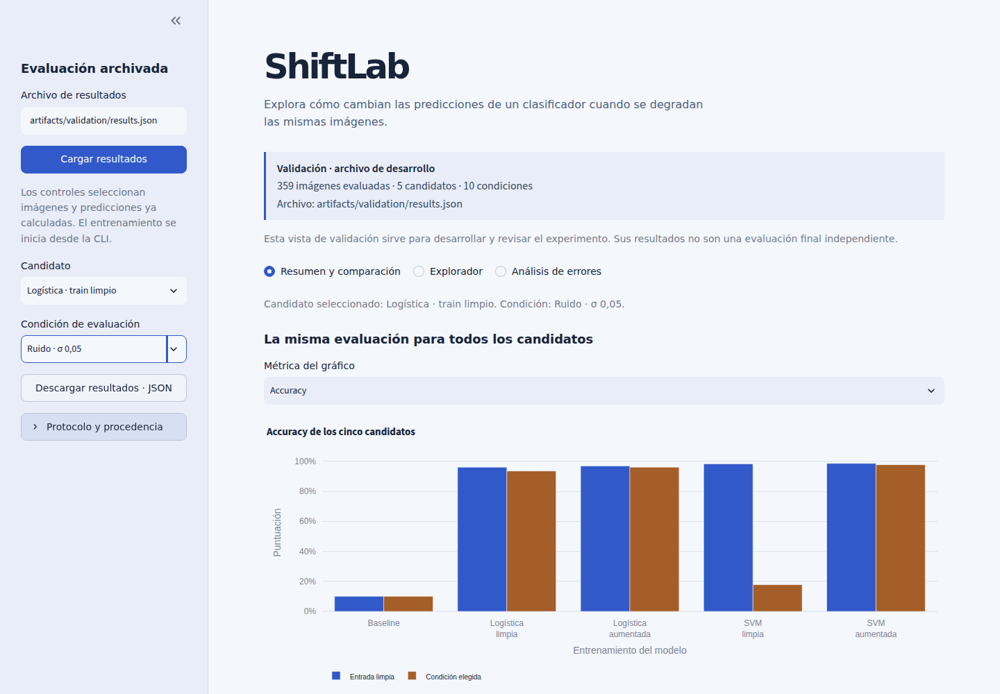

# ShiftLab

¿Cómo cambian las predicciones cuando se degradan las imágenes, y qué cambia al entrenar con aumentación? ShiftLab permite comprobarlo con imágenes reales de dígitos de **8×8**, cinco candidatos pequeños y diez condiciones fijadas de antemano. Los entrenamientos y predicciones se calculan en CPU; ruido, desenfoque y contraste son degradaciones sintéticas.



**Tres vistas:** resumen de los cinco candidatos y curvas; explorador del original y la entrada degradada con sus predicciones; matriz de confusión y errores por clase. Los controles cargan resultados archivados y no entrenan modelos. La descarga JSON procede del mismo objeto que muestran las tablas.

## Abrir el proyecto

**Verificación local del 4 de noviembre de 2026:** instalación limpia con los
45 pins originales, Python 3.12.3 y pip 24.0 en Linux x86_64; `pip check`
correcto y 42 pruebas aprobadas, con dos avisos de deprecación. Se comprobó la
lectura de resultados archivados y la exportación sin sobrescribir destinos.
No se repitió el experimento final. La aplicación se ejecuta localmente; no hay
despliegue cloud. El [workflow de CI](.github/workflows/ci.yml) instala los
requisitos, ejecuta `pip check` y pytest en cada push a main y pull request.
Su [estado y ejecuciones](https://github.com/alvaro-salvador-huertas/shift-lab/actions/workflows/ci.yml)
identifican el commit evaluado; no ejecuta la evaluación final.

Desde esta carpeta, con Python 3.12 disponible:

```bash
python3 -m venv .venv
.venv/bin/python -m pip install -r requirements.txt
.venv/bin/python -m streamlit run app.py --server.address 127.0.0.1 --server.port 8503
```

Abre <http://127.0.0.1:8503> y pulsa **Cargar resultados** con `artifacts/final/results.json`. El repositorio incluye los resultados calculados. Si faltan, recupera los artefactos conservados antes de usar la demo; no hace falta reevaluar test para abrirla. La instalación necesita conexión; después se utiliza el dataset incluido en scikit-learn y la aplicación funciona sin servicios externos.

## Reproducir el experimento

La revisión actual utiliza los archivos conservados. Los comandos siguientes
documentan una ejecución futura separada; **no se han vuelto a ejecutar aquí**.
Una nueva evaluación final necesita su propia decisión y registro, y reutilizar
este test ya observado no aporta confirmación independiente.

Usa una carpeta nueva para conservar los resultados existentes. Cada comando rechaza sobrescrituras:

```bash
.venv/bin/python -m shiftlab prepare --artifacts artifacts/reproduccion-01
.venv/bin/python -m shiftlab cost --artifacts artifacts/reproduccion-01
.venv/bin/python -m shiftlab validation --artifacts artifacts/reproduccion-01
```

Revisa `artifacts/reproduccion-01/training-transformations.png` y las tres vistas de la aplicación cargando `artifacts/reproduccion-01/validation/results.json`. La cuadrícula contiene exclusivamente imágenes de entrenamiento. Solo después de esa revisión:

```bash
.venv/bin/python -m shiftlab freeze --artifacts artifacts/reproduccion-01 --visual-reviewed --review-note "Cuadrícula de train e interfaz revisadas con validación."
timeout 600s .venv/bin/python -m shiftlab final --artifacts artifacts/reproduccion-01
```

La congelación conserva configuración, datos, particiones, versiones y código experimental; no se presenta como una preregistración independiente. El estudio final tiene un límite de 600 s y utiliza un hilo numérico. No hay búsquedas de hiperparámetros ni selección automática del resultado más vistoso.

Para guardar gráficos HTML autónomos, con Plotly incluido y sin CDN:

```bash
.venv/bin/python -m ui.export_figures --results artifacts/final/results.json --output artifacts/figures-revision-01
```

Elige siempre una carpeta de exportación nueva para conservar los gráficos anteriores. Esta exportación usa una comparación fijada con validación: logística limpia, ruido σ=0,05 y accuracy; incluye también los cinco candidatos y la curva limpia/aumentada. Los gráficos no vuelven a entrenar. En la entrega local se conservan además los gráficos de validación en `artifacts/validation/figures-reviewed/`.

## Datos, protocolo y límites

`load_digits` contiene 1797 imágenes reales normalizadas dividiendo por 16. Se agrupan duplicados exactos por hash y se aplica StratifiedGroupKFold con cinco folds y semilla 20261029: **1078 train, 359 validación y 360 test**. En esta carga se encontraron **cero grupos duplicados exactos y cero contradicciones**; la política de agrupación también se comprueba con fixtures que sí los contienen.

Los cinco candidatos son baseline mayoritario, logística limpia/aumentada y SVM RBF limpia/aumentada. Cada original aumentado conserva cuatro versiones con peso 1/4 cada una, tanto en el escalador como en el estimador. Se evalúan limpio y tres intensidades de ruido, desenfoque y contraste. Las imágenes de evaluación son idénticas entre candidatos y las diferencias se emparejan por original; sus versiones no son observaciones independientes.

Las métricas son accuracy y macro-F1 sobre diez clases, acompañadas de matrices, resultados por clase y predicciones por imagen. Una degradación puede mejorar una predicción y la aumentación puede perjudicar una condición. No se convierten márgenes SVM en porcentajes de confianza. El dataset pequeño y las degradaciones elegidas **no acreditan robustez en producción ni generalización a escritores nuevos**.

Dataset: Alpaydin y Kaynak (1998), [UCI Optical Recognition of Handwritten Digits](https://doi.org/10.24432/C50P49), CC BY 4.0 según UCI. Se conserva la atribución y se indican las transformaciones. `load_digits` redistribuye el test original de UCI; esta partición interna no reproduce su separación original por escritores.

## Resultados archivados

Una evaluación final tras congelar el protocolo: **cinco candidatos × diez condiciones × 360 imágenes**. Duración de la fase: **2,365 s**, dentro del límite de 600 s. La comparación con ruido intermedio se fijó al diseñar la vista con validación; aquí se muestran los valores finales de esa misma vista.

| Candidato | Accuracy limpia | Macro-F1 limpia | Accuracy ruido σ=0,05 |
| --- | ---: | ---: | ---: |
| Baseline · clase mayoritaria | 10,00% | 0,0182 | 10,00% |
| Logística · train limpio | 98,06% | 0,9802 | 95,83% |
| Logística · train aumentado | 98,06% | 0,9804 | 97,78% |
| SVM RBF · train limpio | 98,61% | 0,9860 | 22,22% |
| SVM RBF · train aumentado | 99,17% | 0,9914 | 98,89% |

Las diez condiciones y las predicciones completas permanecen en `artifacts/final/results.json`. La logística limpia y aumentada empatan en accuracy limpia, aunque sus macro-F1 difieren; la ventaja observada de aumentación frente a este ruido no acredita una mejora universal. Se evalúa el Pipeline completo, incluido el escalador aprendido de su entrenamiento.

Gráficos HTML autónomos finales: [comparación](artifacts/final/figures/comparacion.html), [curva de ruido](artifacts/final/figures/curva-ruido.html) y [matriz de confusión](artifacts/final/figures/matriz-confusion.html). Los archivos anteriores de validación y las capturas previas se conservan. Repetir ahora el mismo test sirve para reproducir cálculos y no constituye una confirmación independiente.

## Abstención exploratoria sobre validación

Experimento local separado del motor congelado y de la interfaz. Reutiliza la
logística de train limpio y las transformaciones originales; no lee resultados
ni evalúa imágenes del test final. **Es exploratorio:** la validación original
ya se usó en el desarrollo de ShiftLab; dividirla ahora no aporta confirmación
independiente. `max(predict_proba)` es una puntuación de selección, no una
probabilidad calibrada de acertar.

Desde la raíz, con el entorno original y `artifacts/prepared.json` conservado:

```bash
.venv/bin/python -m experiments.abstention --output artifacts/abstention-reproduccion-01
```

El comando exige una carpeta nueva. Ajusta una vez sobre todo el train original
y subdivide únicamente la validación mediante `StratifiedGroupKFold` de dos
folds, con `shuffle=True` y semilla 20261111. Agrupa por el SHA256 original y
mantiene todas las versiones en el subconjunto de su imagen. Con imágenes
limpias del fold 0 elige el mayor umbral que acepte al menos el 95 %
(`score >= umbral`, incluidos empates); lo fija antes de medir el fold 1.

Compara clasificación obligatoria y abstención en esas mismas imágenes,
limpias y con ruido σ=0,05 y σ=0,10. Exporta `results.json` con índices,
grupos, puntuaciones, predicciones, máscaras y recuentos; `cobertura-error.html`
autónomo con curvas descriptivas y puntos del umbral fijado; e `informe.txt`
con el resultado y el comando. Sin aceptadas, la tasa de error es `null`.
Las curvas de medición no se usan para seleccionar otro umbral.

La [nota de abstención](docs/abstencion.md) detalla los errores y aciertos
rechazados, los errores que siguen entre aceptadas y el coste del umbral fijado.
Ejecución local conservada: [informe](artifacts/abstention-20261111/informe.txt),
[JSON](artifacts/abstention-20261111/results.json) y
[gráfica](artifacts/abstention-20261111/cobertura-error.html).
Las pruebas de separación de grupos, umbral y recuentos se ejecutan con
`.venv/bin/python -m pytest -q tests/test_abstention.py`.

## Verificación y aprendizaje

```bash
.venv/bin/python -m pytest -q
.venv/bin/python -m pip check
```

Python comprobado: **3.12.3**; NumPy 2.5.4, pandas 3.1.0, SciPy 1.18.1, scikit-learn 1.9.1, Streamlit 1.66.1 y Plotly 7.1.0. `requirements.txt` registra las versiones instaladas. Los avisos se conservan; scikit-learn 1.9 emite un FutureWarning por el parámetro explícito `SVC(probability=False)`, requerido por el protocolo, que no se oculta.

La revisión distingue pruebas automatizadas, revisión visual y comprobaciones numéricas independientes. Los informes internos se conservan localmente y se excluyen de la publicación. La interfaz y las capturas se desarrollaron y revisaron con validación **antes** de evaluar test. Las capturas anteriores se conservan; no se presentan como evidencia del test final.

- [Protocolo y semillas](docs/protocolo.md).
- [Ficha de uso y limitaciones](docs/ficha.md).
- [Seis preguntas de defensa](docs/defensa-preguntas.md) y [respuestas separadas](docs/defensa-respuestas.md).

Para repetir la navegación local, deja el servidor arrancado e instala el extra opcional. Se requiere Chrome o Chromium ya instalado; el script no descarga navegadores y usa una etiqueta nueva para conservar cada revisión:

```bash
.venv/bin/python -m pip install -r requirements-browser.txt
.venv/bin/python scripts/check_browser.py --source artifacts/validation/results.json --tag revision-nueva
```

Comprobación visual realizada en Chrome 156, 1440×1000 y 390×844. Ejemplos: [curva móvil](docs/screenshots/validation-v2-curva-mobile-detail.png), [comparación móvil](docs/screenshots/validation-v2-comparacion-mobile-detail.png) y [confusión móvil](docs/screenshots/validation-detail-confusion-mobile.png). AppTest simula estados de Streamlit y no sustituye esa revisión en navegador.

Desarrollo e inspección asistidos por IA. El proyecto aporta código y resultados verificables para aprender; no acredita por sí solo dominio profesional. El repositorio distribuye el código y los resultados archivados para revisión; la aplicación se inicia en el equipo local.

*English summary:* A local robustness lab for real 8×8 handwritten-digit images. Five fixed classifiers are compared under clean input and nine synthetic corruptions, using grouped splits, weighted training augmentation and reproducible paired predictions. The interface loads archived results; it does not retrain when controls change. This small benchmark does not establish production robustness or generalisation to unseen writers.

## Contenido necesario para la demo

La aplicación usa `artifacts/final/results.json`, el dataset incluido en
scikit-learn y las fuentes/versiones originales para validar y reconstruir
imágenes. Se incluyen además el NPZ final y `artifacts/frozen/` para verificar
las entradas exactas y la congelación, sin entrenar. Las pruebas de protocolo
necesitan `artifacts/prepared.json` y los resultados de validación; se conservan
también su NPZ, coste, cuadrícula de train y los seis HTML finales/revisados.
Las rutas operativas son relativas a la raíz del proyecto.

La publicación excluye entornos, cachés, informes internos de revisión, logs,
descargas JSON duplicadas y capturas de intentos previos. Conserva código,
pruebas, documentación de uso/protocolo/defensa, requisitos, artefactos de la
demo y atribuciones de terceros. El workflow conserva visibles los dos FutureWarning de SVC; no son avisos
de convergencia ni se ocultan globalmente.

## Licencia

El código propio se distribuye bajo [MIT](LICENSE), con
Copyright (c) 2026 Álvaro Salvador Huertas. El texto estándar procede de
[Choose a License](https://choosealicense.com/licenses/mit/).
El dataset y sus derivados conservan CC BY 4.0 según UCI; las dependencias y
recursos de terceros mantienen sus propias licencias y avisos. Consulta
[procedencia y avisos](docs/TERCEROS.md). MIT no sustituye esas condiciones.
